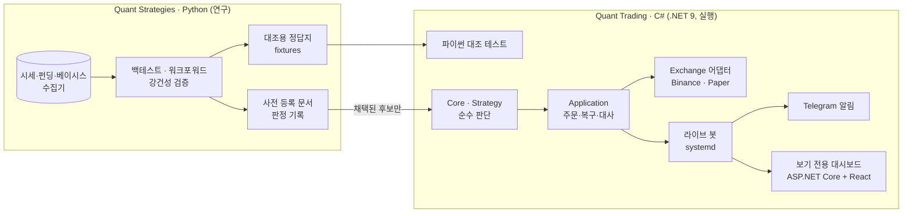
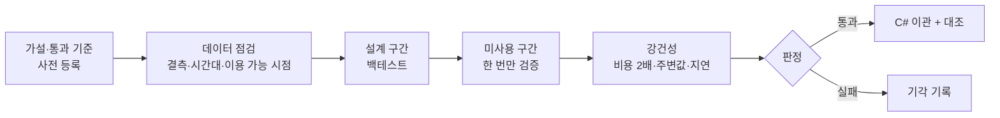

# Quant — 검증 우선 크립토 자동매매 시스템

> **Python으로 전략을 검증하고, C# (.NET)으로 실행하는 24시간 자동매매 봇.**
> 수익률보다 "이 숫자를 믿어도 되는가"를 먼저 묻는 방식으로 만들었습니다.

[English summary](#english-summary) · [아키텍처](docs/ARCHITECTURE.md) · [연구 방법](docs/RESEARCH_PROCESS.md) · [검증 결과](docs/RESULTS.md) · [엔지니어링 기록](docs/ENGINEERING.md) · [코드 샘플](code-samples/)

| 기간 | 형태 | 운영 | 개발 방식 |
|---|---|---|---|
| 2026.04 – 진행 중 | 개인 프로젝트 | Linux 서버 · systemd · 24시간 | Claude Code · Codex와 함께 개발 (커밋 509개 중 490개 AI 작성, 설계·판정·검수는 본인) |

---

## 한눈에 보기

| 숫자 | 의미 |
|---|---|
| **261 / 261** | 7년 백테스트에서 Python 연구 엔진과 C# 실행 엔진의 거래가 1건도 빠짐없이 일치 |
| **110 / 110** | 데모 운영 두 달 동안 봇이 매일 내린 판단이 연구 코드의 재계산과 모두 일치 |
| **약 2,000건** | 자동 테스트 (C# 1,104건 + Python 976건) — 파이썬 대조, 사고 방어, 구조 검사 |
| **12 / 12** | 추세추종 전략이 결과를 보기 전에 정한 실전 투입 조건을 모두 통과 |
| **기각 다수** | 엔트리 확장 4연속, 공개 논문 전략 4종, 눌림목 개선안 5회 — 처음 보는 데이터에서 버티지 못한 아이디어는 실전에 넣지 않음 |

> 전략의 구체적인 판단 규칙과 실전 파라미터는 비공개입니다. 이 레포는 **시스템 설계, 검증 방법, 결과, 교훈**을 정리한 공개용 문서입니다.

---

## 왜 만들었나

처음에는 "백테스트 수익률이 좋은 전략"을 찾으려 했습니다. v1부터 v7까지 고치면서 배운 것은,
**백테스트 숫자는 아주 쉽게 거짓말을 한다**는 사실이었습니다.

- 무위험 연 8%로 하드코딩된 한 줄이 델타 중립 전략 순익의 78%를 만들고 있었습니다.
- 짧은 시간봉에서는 수수료가 수익을 통째로 삼켰습니다.
- 같은 규칙이 세 곳에 복사돼 있었고, 한 곳만 고쳐서 백테스트와 실전이 조용히 어긋났습니다.

그래서 목표를 바꿨습니다. **"좋아 보이는 전략"이 아니라 "믿을 수 있는 숫자를 만드는 시스템"**을 먼저 만들고,
그 시스템을 통과한 전략만 실제 돈으로 돌립니다.

---

## 시스템 구성

| 영역 | 내용 |
|---|---|
| **연구 (Python)** | pandas·NumPy 기반 백테스트, 워크포워드, 미사용 구간 검증, 비용 민감도, 주변 파라미터 검사. 모든 판정은 실행 전에 기준을 적는 **사전 등록** 문서로 남김 |
| **실행 (C#)** | Ports & Adapters 구조. 판단(Core·Strategy)은 파일·네트워크를 모르고, 거래소·저장·알림은 바깥 어댑터. 경계는 ArchUnitNET 테스트가 CI에서 지킴 |
| **봇** | 전략별 독립 프로세스(systemd). 설정은 fail-closed — 값이 빠지거나 범위를 벗어나면 기본값으로 대체하지 않고 멈춤 |
| **대시보드** | ASP.NET Core + React + lightweight-charts. 잔고·포지션·백테스트 성적표를 보여 주며 **주문 경로가 아예 없음** (테스트로 강제) |
| **운영** | Linux 서버 systemd, preflight 검사, 버전 각인, 배포 스크립트의 전체 테스트·롤백, Telegram 알림, GitHub Actions CI |

자세한 내용: [docs/ARCHITECTURE.md](docs/ARCHITECTURE.md)

---

## 연구 방법 — "결과를 보기 전에 기준을 적는다"

- 수익률 하나로 판정하지 않고 CAGR·MDD·샤프·거래 수·비용·연도별 성과를 함께 봅니다.
- 여러 설정을 시도했다면 그 횟수만큼 할인합니다 (Deflated Sharpe Ratio).
- 최종 검증 구간을 본 뒤 고친 전략은 다시 "미사용 검증"이라 부르지 않습니다.
- 실패한 실험도 지우지 않고 기록합니다.

자세한 내용: [docs/RESEARCH_PROCESS.md](docs/RESEARCH_PROCESS.md)

---

## 주요 결과

### 추세추종 (BTC 현물, 다중 이동평균 앙상블) — 실전 투입 판정 통과

설계에 쓰지 않은 2018년 약세장 구간을 포함해 사전 조건 12개를 모두 통과했습니다.

| 구간 | 전략 수익 | MDD | 샤프 | BTC 보유 수익 | 보유 MDD | 보유 샤프 |
|---|---|---|---|---|---|---|
| **미사용 2018-03 ~ 2019-09** | **+58.3%** | **−29.4%** | 0.95 | −8.2% | −72.0% | 0.28 |
| 전체 2018-03 ~ 2026-08 | +1,890% (CAGR 42.2%) | −43.8% | 1.09 | +582% | −76.6% | 0.68 |

- 비용 2배, 체결 하루 지연, 파라미터 ±20%에서도 샤프 1.0 이상 유지
- **한계도 같이 적었습니다**: 수익이 32번의 보유 구간 중 상위 3번에 몰려 있고, 단독 MDD −44%, 회복 최장 962일. 강세장에서는 보유보다 덜 법니다.

### 그 밖의 판정

| 전략 | 결과 | 한 줄 이유 |
|---|---|---|
| 델타 중립 펀딩 캐리 | 소액 실전 운영 | 안전장치는 검증됐지만 현재 국면 기대 수익 연 0~2% — 예치 이자와 비슷 |
| 눌림목 (BTC 1h 선물) | 데모만 유지 | 7년 MAR 0.34, 수수료가 수수료 전 손익의 48%. 개선안은 다른 종목에서 일반화 실패 |
| 공개 논문 전략 4종 | 채택 0 | 논문 샤프 1.58 → 우리 데이터 0.52 등 |
| 횡단면 모멘텀 롱숏 | 페이퍼 추적 중 | 사전 등록 후 26주·52주 판정 대기 |

전체 표와 근거: [docs/RESULTS.md](docs/RESULTS.md)

---

## 엔지니어링 하이라이트

- **"라이브 봇 코드의 절반은 신호가 아니라 사고 방어다."** 응답 끊김, 중복 체결, 재시작, 보호 주문 실패, 결과 불명 주문 — 실제로 겪은 사고마다 방어 코드와 그 사고를 재현하는 테스트를 남겼습니다.
- **몫 장부 (Sleeve ledger)**: 한 계좌를 여러 전략이 쓰다가 추세추종 봇이 다른 전략의 $5,000를 BTC로 사 버린 사고 이후, 각 전략이 지갑이 아니라 자기 몫만 보게 만들었습니다. → [Sleeve.cs](code-samples/Sleeve.cs)
- **구조를 테스트로 고정**: "판단 코드는 파일·네트워크 금지", "대시보드는 주문 인터페이스 금지"를 ArchUnitNET으로 강제합니다. → [ArchitectureTests.cs](code-samples/ArchitectureTests.cs)
- **모르는 값은 0이 아니라 null**: 체결량·수수료를 0이나 추정치로 채우면 장부가 틀린 채 확정됩니다. 화면도 null은 `—`로 그립니다.
- **파이썬이 정답은 아니다**: 이관 과정에서 파이썬 쪽 버그(비표준 ATR, 일일 손실 기준, MDD 고점 미기록 등)를 여러 개 찾았고, TA-Lib·거래소 문서로 3자 검증했습니다.

자세한 내용: [docs/ENGINEERING.md](docs/ENGINEERING.md)

---

## 기술 스택

| 분류 | 사용 기술 |
|---|---|
| 실행 엔진 | C# · .NET 9 · Binance.Net · xUnit · ArchUnitNET |
| 연구 | Python 3.12 · pandas · NumPy · SciPy · ccxt · pyarrow · pytest · matplotlib/plotly |
| 대시보드 | ASP.NET Core · React 18 · TypeScript · Vite · lightweight-charts |
| 운영 | Linux · systemd · Tailscale · Telegram Bot API · GitHub Actions |
| AI 개발 도구 | Claude Code · Codex · ChatGPT |

## 규모

| | |
|---|---|
| C# | 약 61,000줄 · 288파일 (테스트 약 19,000줄) |
| Python | 약 59,000줄 · 281파일 (테스트 약 16,000줄) |
| 대시보드 (TS/TSX) | 약 4,900줄 |
| 커밋 | 509개 (C# 430 · Python 79) |

---

## 이 프로젝트에서 배운 것

1. **검증은 엣지를 찾는 도구가 아니라 가짜 엣지를 거르는 도구다.** 가설 대부분이 기각됐고, 그게 시스템이 제대로 작동한다는 증거였습니다.
2. **비용이 전략을 결정한다.** 거래 빈도를 낮추고 비용을 정확히 넣는 것만으로 많은 "좋은 전략"이 사라졌습니다.
3. **백테스트와 실전이 같은 코드를 쓰게 만드는 것이 가장 큰 안전장치다.** 판정 규칙은 한 곳에만 두고, 두 언어 구현은 정답지로 대조합니다.
4. **AI는 구현 속도를 바꿨지만 판단을 대신하지 않는다.** 무엇을 검증할지, 어떤 기준으로 기각할지, 언제 실제 돈을 넣을지는 사람이 정하고 문서로 남겼습니다.

---

## 공개 범위

이 레포는 포트폴리오용 공개 문서입니다. 아래는 의도적으로 제외했습니다.

- 전략의 구체적인 판단 규칙·파라미터, 실전 설정
- API 키, 서버 주소, 계좌 정보, 실제 잔고
- 원본 소스 코드 전체와 시세 데이터 (비공개 레포에서 관리)

`code-samples/`의 파일은 전략 판단과 무관한 인프라 코드를 원본에서 그대로 가져온 발췌본이며, 단독으로 빌드되지 않습니다.

> 이 문서는 투자 권유가 아닙니다. 기록된 수익률은 과거 데이터 기반 백테스트이며 미래 수익을 보장하지 않습니다.

---

## English summary

**Quant** is a personal, validation-first crypto trading system (2026.04 – present).
Strategies are researched in **Python** (pandas/NumPy) under a pre-registration discipline — hypotheses, baselines and pass criteria are written *before* running a test, with untouched hold-out periods, cost-stress and parameter-neighborhood checks.
Only strategies that pass are ported to a **C# / .NET 9** execution engine built with a Ports & Adapters architecture, enforced by ArchUnitNET tests in CI.

- Python and C# engines matched **261/261 trades** over a 7-year backtest; live demo decisions matched research recomputation **110/110 days**.
- ~2,000 automated tests (1,104 C# + 976 Python), many of them reproductions of real production incidents (dropped responses, duplicate fills, restarts, failed protective orders).
- A BTC trend-following ensemble passed all 12 pre-registered live-readiness criteria, including an unseen 2018 bear market (+58% vs −8% buy-and-hold, MDD −29% vs −72%). Most other ideas were rejected and documented.
- Read-only monitoring dashboard (ASP.NET Core + React) with no order path by design; bots run 24/7 under systemd with fail-closed configuration and Telegram alerts.
- Built with AI coding agents (Claude Code, Codex): 490 of 509 commits were AI-written, while research design, acceptance decisions and review stayed human.

Strategy rules, live parameters, credentials and the full source are kept private.
