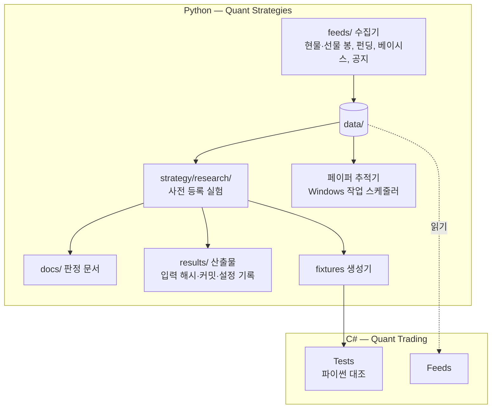
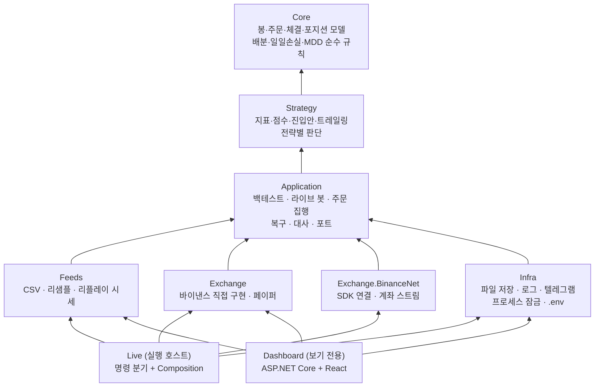
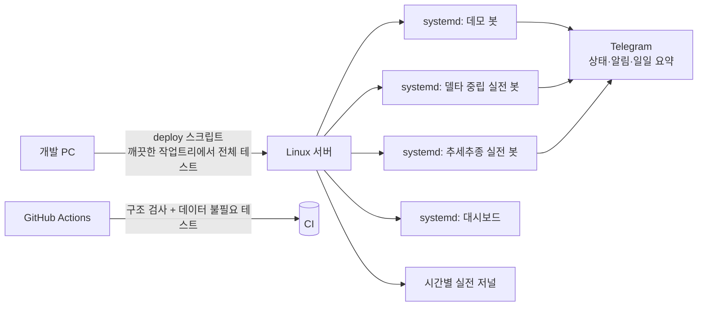

# 아키텍처

[← README](../README.md)

## 1. 두 저장소, 두 언어

| 저장소 | 언어 | 역할 |
|---|---|---|
| **Quant Strategies** | Python | 데이터 수집, 전략 탐색, 백테스트, 강건성 검증, 페이퍼 추적, 대조용 정답지 생성 |
| **Quant Trading** | C# (.NET 9) | 채택된 전략의 실행 — 백테스트 엔진, 라이브 봇, 주문·복구·대사, 대시보드 |

2026-09에 둘로 나눴습니다. 연구는 짧은 실험 주기와 데이터 분석 도구가 중요하고,
실행은 타입 안정성·장기 운영·사고 방어가 중요하기 때문입니다.
시세 데이터는 Python 쪽 한 곳에만 두고 C#이 그 경로를 읽습니다 — 두 벌을 두면 조용히 갈라집니다.



## 2. C# 실행 엔진 — Ports & Adapters

안쪽(Core·Strategy·Application)은 바깥(거래소·파일·텔레그램)을 모르고,
바깥이 Application의 포트 인터페이스를 구현합니다.



| 계층 | 책임 | 금지 |
|---|---|---|
| Core | 도메인 모델, 순수 규칙 | 어떤 프로젝트도 참조하지 않음 |
| Strategy | 지표·점수·진입안 — **같은 입력이면 같은 판단** | `System.IO`, `System.Net` |
| Application | 실행 절차: 시간 진행, 주문 집행, 체결 회계, 복구, 대사 | 거래소 SDK 타입 |
| Feeds / Exchange / Infra | 포트 구현(어댑터) | 서로를 직접 참조하지 않음 |
| Live | 명령 분기, 구현 선택(Composition) | Composition 밖에서 구현 생성 |
| Dashboard | 감시 화면 | 주문 인터페이스, 봇 명령함 |

이 규칙은 문서가 아니라 **테스트**입니다. `ArchitectureTests`(ArchUnitNET)가 프로젝트 참조 허용 목록과
타입 의존을 검사하고, `Directory.Build.props`가 전이 참조를 꺼서 쓰는 참조가 csproj에 직접 드러나게 합니다.
→ [code-samples/ArchitectureTests.cs](../code-samples/ArchitectureTests.cs)

## 3. 라이브 봇의 한 tick

순서가 결과를 가릅니다.

```
캔들·지표 → 하트비트 기록 → 청산 확인 → 거래소-장부 대조
→ 트레일링 → 추가 진입 → 가드(포지션·일일손실·MDD·쿨다운) → 국면 필터 → 트리거 → 점수
```

청산 확인이 **대조보다 먼저**여야 합니다. 반대로 두면 자가치유 로직이 봇 자신의 청산을 장부 없이 지워서,
2025년 리플레이에서 이긴 거래 24건이 통째로 사라졌습니다.

사고 방어는 책임별로 나뉘어 있습니다.

| 모듈 | 막는 사고 |
|---|---|
| PositionOrders | 취소 확인 실패, 보호 주문 실패 시 안전 청산·롤백 |
| ExitBooking | 체결 회계 누락, 정산 대기 |
| PositionRecovery | 재시작 후 보호 주문 재무장, 고아 주문 정리 |
| EntryLock | 진입 중 프로세스가 죽었을 때의 복구 저널 |
| SelfHealer | 장부와 거래소 상태 불일치 |
| PositionReconciler | 거래소-장부 대사 |

## 4. 여러 전략, 하나의 계좌 — 몫 장부와 종목 주인 목록

- **몫 장부(Sleeve)**: 전략은 지갑 잔고가 아니라 자기 몫(원금·현금·보유 자산)만 보고, 몫은 자기 체결로만 움직입니다.
  선물은 거래소의 손익 내역(실현손익·수수료·펀딩)을 종목·보유 기간으로 갈라 적습니다 — 체결 회계와 독립인 제3자 기록입니다.
  → [code-samples/Sleeve.cs](../code-samples/Sleeve.cs)
- **종목 주인 목록**: 봇마다 자기 종목을 공용 폴더에 적고 기동할 때 맞댑니다. 겹치면 뜨지 않습니다.
- 실전은 전략마다 **서브계정**을 써서 이 문제 자체를 없앴습니다.

## 5. 설정과 감시

| 원칙 | 구현 |
|---|---|
| 설정은 **fail-closed** | `.env` 값이 없거나 범위를 벗어나면 기본값으로 대체하지 않고 멈춤. 실전 모드는 별도 확인 플래그까지 있어야 기동 |
| 감시 화면은 **fail-visible** | 출처 하나가 죽어도 화면은 뜨고, 죽었다는 사실을 표시 |
| 대시보드는 **보기 전용** | 인터넷 공개 전에 조작 버튼을 제거. 토큰이 새도 계좌를 움직일 경로가 없음 — 구조 검사가 되살아나지 못하게 막음 |
| 모르는 값은 **null** | 체결량·평균가·수수료를 0이나 추정치로 채우지 않음. 화면은 `—` |
| API 키 권한 검사 | 출금 권한이 있거나 IP 제한이 없는 실전 키는 거부 |

## 6. 운영



- 각 봇은 `ExecStartPre` preflight 검사를 통과해야 기동합니다.
- 서버에 설치된 커밋을 파일로 각인해 "지금 무엇이 돌고 있는가"를 코드 HEAD가 아니라 서버 기준으로 확인합니다.
- 텔레그램 명령은 봇 하나만 받고, 다른 봇의 장부를 읽어 같은 모양의 상태 칸으로 답합니다.
- 시세 파일이 필요한 테스트는 `Category=Data`로 표시해 CI에서 빼고, 배포 스크립트가 전체를 돌립니다.
